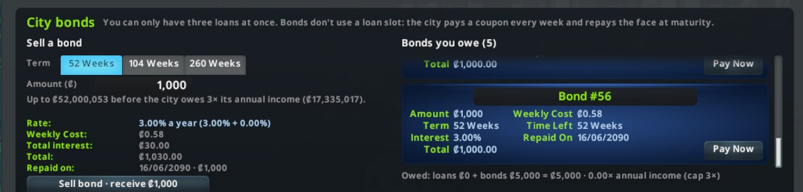

# City bonds

Bonds raise money now and pay it back later, without using one of the game's three loan slots. Find
them at the top of **Economy → Loans**.

## Selling a bond

1. Pick a term: **52, 104 or 260 Weeks**.
2. Type the amount in ₡ (it groups as you type). The panel shows the rate, the weekly cost, the
   total interest, the total and the repayment date.
3. Click **Sell bond**. The cash arrives at once.

The rate is the base rate for the term plus a premium that grows with how much the city already
owes. The market refuses a bond that would leave the city owing more than three times its annual
income; the panel tells you the most you can raise.

## Bonds you owe

Each bond is a card like the game's loans: its amount, term, interest, weekly cost, time left, the
day it is repaid and the Total that paying now costs. Type a name in its box (it starts as
`Bond #63`) to remember what the money was for; the name is saved with the city.

- A coupon (the interest) goes out **every week**, like a loan payment, and shows in Economy under
  loan expenses.
- The amount you raised is repaid with the last coupon.
- **Pay Now** pays a bond off early: the amount raised plus the interest built up since the last
  coupon.

The list scrolls when you owe several bonds. City Treasury chirps when a bond is repaid (see
[Notices](./notices.md)).
