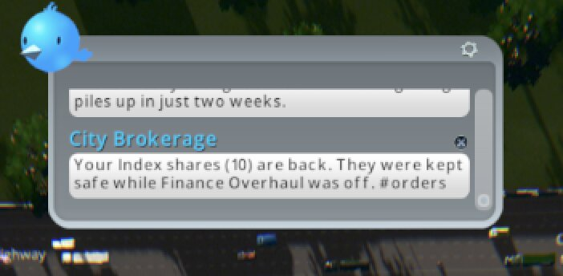

# City Index stock

**Index** (symbol IDX) is one stock that tracks all of the city's share stocks together, like a
total-market fund for your city. Buy it to own the whole market at once: one bad day in a single
industry hurts Index much less than holding that industry alone.

## How it moves

Each game day Index moves by the average daily change of the unlocked share stocks (coins such as
ChirperCrypto are left out). As more sectors unlock, more stocks join. Its 30-day chart is filled in
from the first day, so you can judge it straight away.

## Using it

Buy and sell Index like any other stock in **Economy → Investments**, place orders on it, and follow
it in the [Stock Monitor](./stock-monitor.md) and on the [LED ticker](./led-ticker.md).

If you play a while without the mod, the game drops Index from Investments; your shares come back
when you turn the mod on again (see [Saves](./saves.md)).
