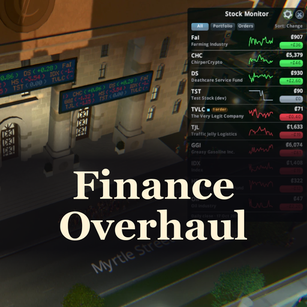

# Finance Overhaul player guide

Finance Overhaul turns the Financial Districts Stock Exchange into a trading desk for your city's
treasury. Version 0.1.

- [About this guide](./about-this-guide.md)
- [Install and first run](./install-and-first-run.md)
- [Buying, selling and orders](./trading-and-orders.md)
- [Stock Monitor](./stock-monitor.md)
- [LED ticker on the Stock Exchange](./led-ticker.md)
- [City Index stock](./city-index-fund.md)
- [City bonds](./city-bonds.md)
- [Chirper notices](./notices.md)
- [Saves and turning the mod off](./saves.md)
- [Options](./options.md)
