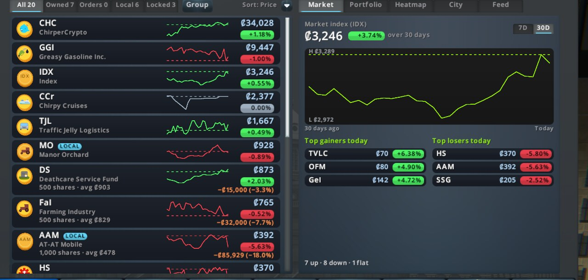
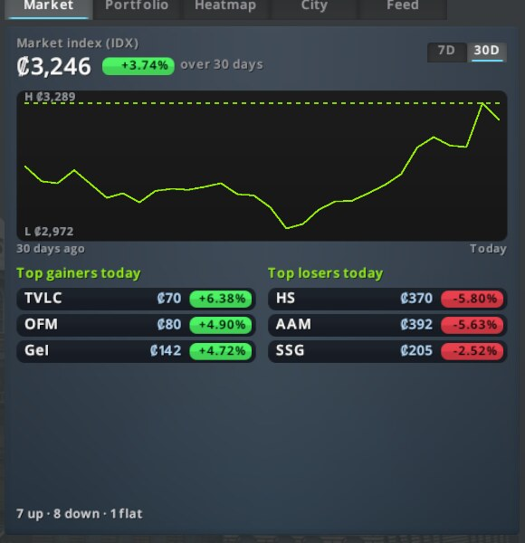
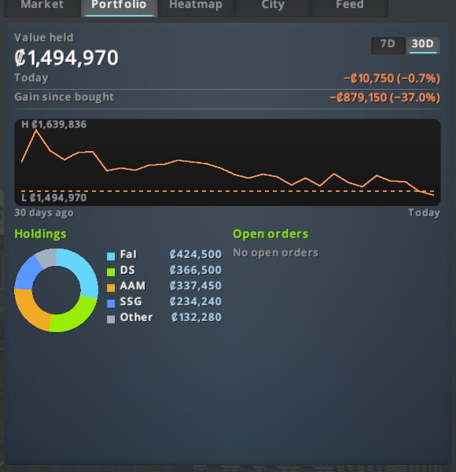
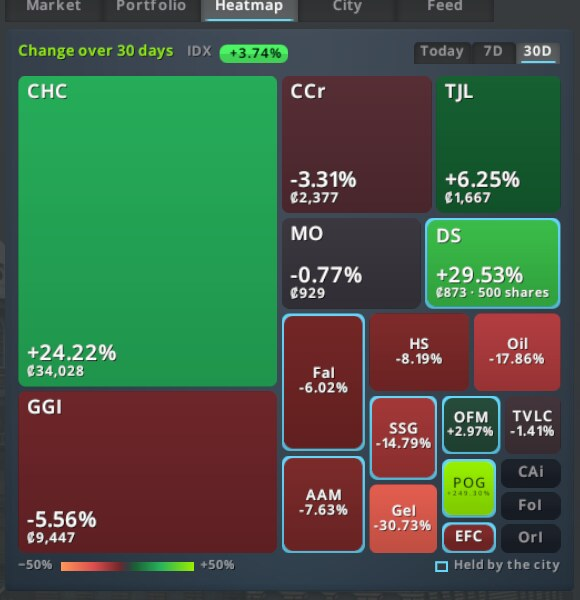
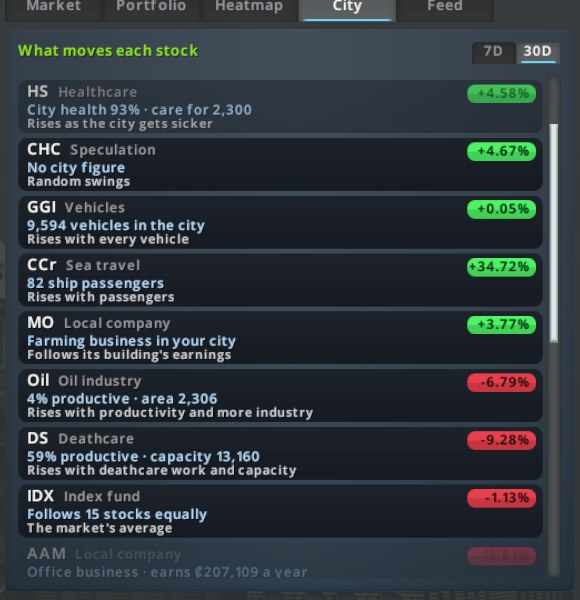
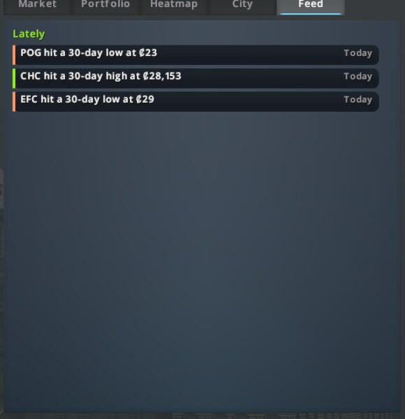

# The Investments tab

**Economy → Investments** is one list of every stock, with an overview of the market beside it.

## The list (left)

Each line is one stock: its coin, symbol and name, a 30-day line, today's price and today's change.
A stock the city holds also shows the shares, the average cost per share and the gain or loss since
you bought; a **LOCAL** badge marks [a company from your own city](./local-ipos.md). Open orders sit
just under their stock, with **Cancel** and the days left.

- **All · Owned · Orders · Local · Locked** filter the list; each tab shows how many it holds.
- **Group** splits All into Your portfolio, Local companies and All stocks.
- **Sort** cycles Change, Symbol, Price and Value held; the arrow reverses it.
- **A click on a line** opens the game's Invest dialog: Buy, or Sell when there is nothing left to
  buy (see [Buying, selling and orders](./trading-and-orders.md)).
- **A click on any change pill** shows every change in ₡ (points) instead of %, and back.
- A locked stock shows what the game still needs before you can buy it.

The list and the [Stock Monitor](./stock-monitor.md) share one sort and one % / ₡ by default, and
the Stock Exchange's [LED boards](./led-ticker.md) follow the pills too. To give the list its own,
untick **Link the Investments list and the Stock Monitor** in [Options](./options.md).

## The overview (right)

Five views, picked with the tabs above it. The view and the 7D | 30D range are remembered. A click
on a stock in any view opens its Invest dialog.

**Market:** the market index (the [Index stock](./city-index-fund.md), IDX, when it is listed) over
7 or 30 days with its high and low, today's top three gainers and losers, and how many stocks rose,
fell or stayed flat.

**Portfolio:** what the city's shares are worth, today's change and the gain since bought, a chart
of what today's holdings were worth each day, a donut of your holdings by value, and your open
orders with Cancel.

**Heatmap:** every stock as a tile, coloured from orange (falling) to green (rising) by its change
today or over 7 or 30 days. Bigger tiles are bigger companies (market value). Stocks you hold are
outlined; the Index has no tile of its own (it is the average of the tiles) and shows its change by
the heading.

**City:** each stock beside the city figure the game reads every day to set its price, such as oil
industry productivity, the crime rate or the vehicles on the road, with what moves it ("Rises with
crime") and its change. It is in the list's order.

**Feed:** **Coming up** (companies about to start trading, orders close to their trigger or about to
end, stocks about to unlock; shown only when something is) and **Lately** (big moves, 30-day highs
and lows, new listings, and this session's [notices](./notices.md)). A click on an item that was a
chirp opens it in the Chirper.

