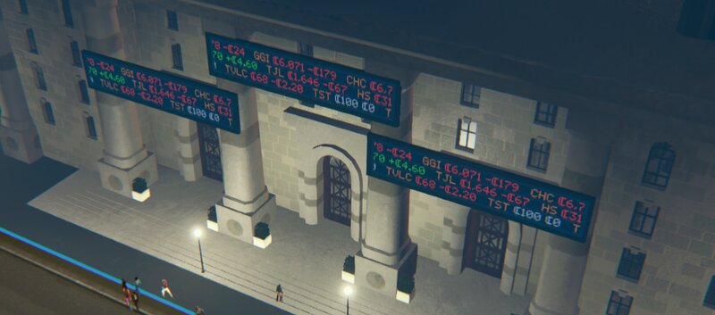

# LED ticker on the Stock Exchange

The boards on the Stock Exchange building scroll real prices on an LED dot-matrix display: green for
up, red for down, grey for unchanged. They are full as soon as the city loads.

In [Options](./options.md) you can choose:

- **Stock Exchange ticker shows:** as the change pills show it (the default: a click on any % / ₡
  pill turns the boards too), change % (`FaI ( +1.07 )`), or price and ₡ change.
- **LED ticker brightness:** Classic, Bright (default) or Brightest for daylight.
- **Show the LED ticker in info views:** keep it on in traffic, population and other info views, or
  hide it there like the game's own boards.
- **Live Stock Exchange ticker:** off brings back the game's original boards.
