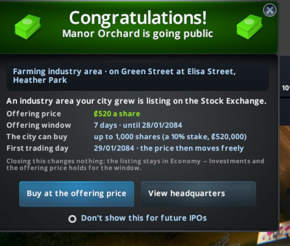
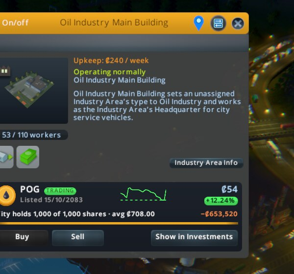

# Local IPOs

A business that has done well in your city for a long time can **go public**: it lists on the Stock
Exchange as a stock of its own, and the city can buy a stake in it.

## What can go public

- **Shops, offices and industry** at the top level of their kind (level 3, or the one level of a
  specialisation such as leisure, tourism, organic produce, IT cluster, farming, forestry, oil or
  ore).
- **Industry areas** at level 3 or above, and **unique factories** running at full production.
- Only a business that has been **healthy for a year**: staffed, no problem icons, and among the
  larger employers of its kind (at least 45 workers).
- Shops and offices also need good land value.

IPOs are rare on purpose: a kind of business needs 200 squares in your city before its first
listing, at most two companies list in a year, and **none list until your Stock Exchange reaches
level 2**. Listed companies are under the **Local** tab of the
[Investments tab](./investments-tab.md).

## The IPO

1. **Announcement:** City Brokerage chirps, and a dialog shows the company, its building, the
   offering price and the dates. **View headquarters** takes the camera there.
2. **Offering window (7 days):** the city can buy up to 1,000 shares (a 10% stake) at the offering
   price. The price comes from what the business earns.
3. **First trading day:** the price opens up or down from the offering price, usually a little up,
   now and then a lot, sometimes down.
4. **After that** it moves every day: up as the business earns more, down as it earns less, with a
   daily swing like the game's own stocks.

The building is marked **Historical** while the company is listed. Its info panel shows the listing,
with Buy, Sell and Show in Investments.

## Later on

- **Buy-outs:** now and then a listed company is bought out at a premium. The city's shares are sold
  at the buyer's price and the company leaves the exchange.
- **Losing its headquarters:** if its building is demolished, abandoned or burns down, the company
  moves to another healthy business of its kind and keeps trading. If none can take it in, its price
  falls for 90 days while it keeps looking, then it closes and the city is paid the last price.

Chirper tells you each step ([Notices](./notices.md)).

## Options

**Show a dialog when a local company goes public** turns the IPO dialog on or off (the chirp stays).
Every value Local IPOs uses is an option in four groups (when companies list, which businesses can
list, prices, buy-outs and closing), with **Less likely**, **Default** and **More likely** presets
and your own saved presets. See [Options](./options.md).

Your companies are kept in the save. Without the mod they leave Investments and come back, with your
shares, when the mod is on again (see [Saves](./saves.md)).
