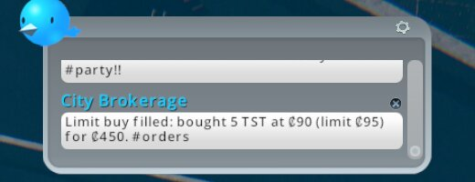

# Chirper notices

The mod tells you what happened through Chirper.

| From           | When                                                                                       |
| -------------- | ------------------------------------------------------------------------------------------ |
| City Brokerage | An order fills, expires or is cancelled                                                    |
| City Brokerage | A [local company](./local-ipos.md) goes public, starts trading, moves, closes or is bought |
| City Brokerage | Your Index shares came back after time without the mod                                     |
| City Treasury  | A bond is repaid at maturity (and every coupon, if you turn that on)                       |

On a busy day with more than three order updates, they arrive as one summary chirp. Turn notices
off, or add a chirp for every bond coupon, in [Options](./options.md).

This session's notices also appear in the Investments overview's **Feed** (a click opens the chirp
in the Chirper) and in each stock's **Chirps** tab in the Invest dialog.
