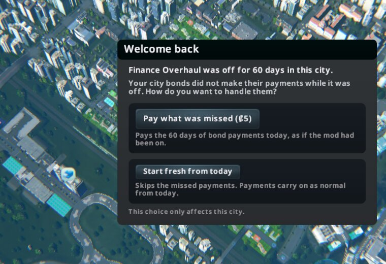

# Saves and turning the mod off

Your city always opens without Finance Overhaul. Turning the mod off never breaks a save.

- **Orders and bonds** are stored in the save and come back when you turn the mod on again.
- **Index shares** disappear from Investments while the mod is off, and come back with the mod (a
  City Brokerage chirp says so).
- **Missed bond payments:** if you play days without the mod, bonds cannot pay. The first time the
  city loads with the mod again, a Welcome back window asks what to do:

- **Pay what was missed** pays them all today, as if the mod had been on.
- **Start fresh from today** skips them; payments carry on as normal. Closing the window does the
  same. A bond that reached its end while the mod was off is still repaid.

If you stop using the mod for good, sell your Index shares and repay your bonds first, or they are
lost with the mod (the cash you raised stays).
