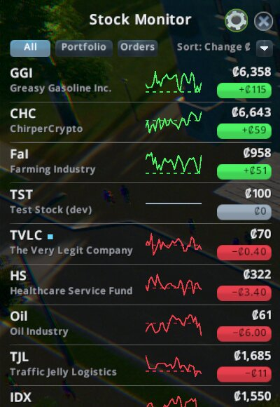

# Stock Monitor

A window that lists every stock at once. Open it with the round **Stock Monitor** button in the
top-left row of mod buttons; drag the button with the right mouse button to move it.

## The list

- Each row: symbol and name, a 30-day sparkline (the dashed line is yesterday's close), today's
  price and today's change.
- **All / Portfolio / Orders** filter the list to everything, what you own, or stocks with open
  orders.
- **Sort** cycles Change, Symbol, Price and Value held; the arrow button beside it reverses the
  order.

## A stock's detail

Click a row for its chart (7 or 30 days), today and yesterday, the 30-day high and low, what you own
and your average cost, your gain or loss and your open orders. Hover over the chart to read any
day's price. **Buy** and **Sell** open the game's dialog with the order tabs.

## Settings (gear button)

Background opacity, solid while the mouse is over it, compact rows, sparklines on or off, change in
₡ instead of %, and which stocks are shown. The game's own **Share value** charts in the Invest
dialog use the same style.
