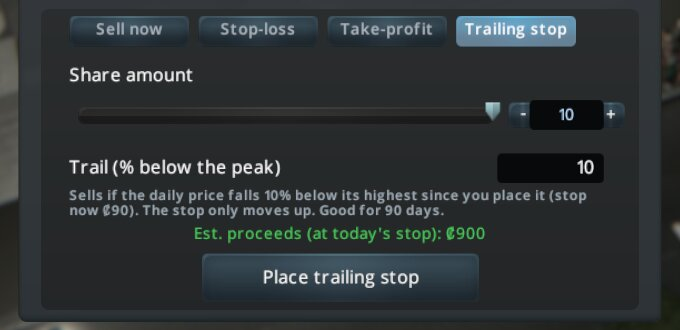
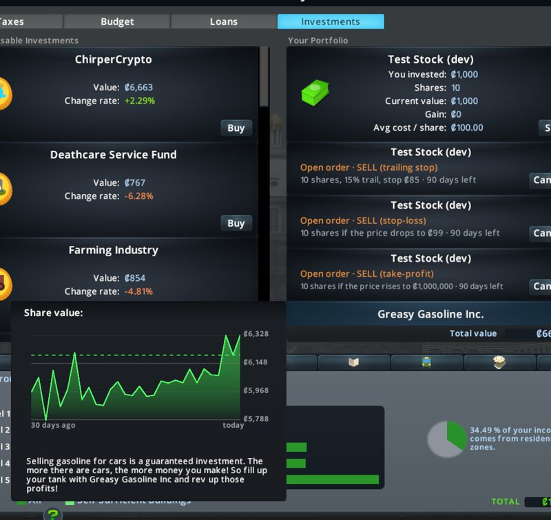

# Buying, selling and orders

## Type the number of shares

In **Economy → Investments**, click **Buy** or **Sell**. Click the share count next to the slider
and type the number you want. **Enter**, **Tab** or a click elsewhere applies it; **Escape** puts
back the number you started with. Numbers above what you can afford (or own) snap to the maximum.

## Orders

Orders let the city trade while you build. They are checked once per game day, at the daily close,
and stay open for 90 days unless you change that in [Options](./options.md).

| Order         | Where                 | What it does                                                                                   |
| ------------- | --------------------- | ---------------------------------------------------------------------------------------------- |
| Limit buy     | Buy dialog, **Limit** | Buys when the daily price is at or below your limit                                            |
| Stop-loss     | Sell dialog           | Sells if the price falls to your stop, to limit a loss                                         |
| Take-profit   | Sell dialog           | Sells once the price rises to your target                                                      |
| Trailing stop | Sell dialog           | Sells if the price falls a set % below its highest since you placed it; the stop only moves up |

Each ticket shows what will happen before you place it, for example "Est. proceeds (at today's
stop)". When an order's price is reached:

- a limit buy fills if the city has the cash and is under the game's 1,000-share limit for that
  stock; otherwise it is cancelled, and City Brokerage tells you why;
- a sell order sells the shares the city still holds, up to the number you set; if it holds none, it
  is cancelled.

## Your Portfolio

Open orders appear in **Your Portfolio** under their stock, with a **Cancel** button and the days
left. Every holding also shows **Avg cost / share**, so you can see at a glance whether it is up or
down for you.

