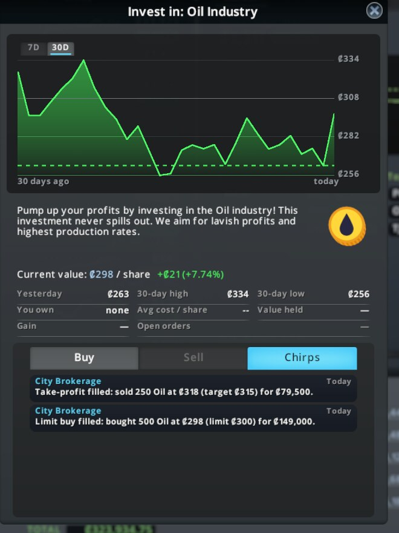

# Buying, selling and orders

A click on a stock (in the [Investments tab](./investments-tab.md), the overview or the
[Stock Monitor](./stock-monitor.md)) opens the game's **Invest** dialog. The mod adds to it:

- **7D | 30D** on its chart, the change since yesterday next to the current value, and the stock's
  stats: yesterday, the 30-day high and low, shares owned, average cost, value held, gain and open
  orders.
- **Buy | Sell | Chirps** tabs: turn the open dialog from buying to selling and back, or read its
  chirps. Sell is greyed out, with a tooltip, when the city holds none.
- The order types for each side, and a typed share amount.

## Type the number of shares

Click the share count next to the slider and type the number you want. **Enter**, **Tab** or a click
elsewhere applies it; **Escape** puts back the number you started with. Numbers above what you can
afford (or own) snap to the maximum.

## Orders

Orders let the city trade while you build. They are checked once per game day, at the daily close,
and stay open for 90 days unless you change that in [Options](./options.md).

| Order         | Where               | What it does                                                                                   |
| ------------- | ------------------- | ---------------------------------------------------------------------------------------------- |
| Limit buy     | Buy side, **Limit** | Buys when the daily price is at or below your limit                                            |
| Stop-loss     | Sell side           | Sells if the price falls to your stop, to limit a loss                                         |
| Take-profit   | Sell side           | Sells once the price rises to your target                                                      |
| Trailing stop | Sell side           | Sells if the price falls a set % below its highest since you placed it; the stop only moves up |

Each ticket shows what will happen before you place it, for example "Est. proceeds (at today's
stop)". When an order's price is reached:

- a limit buy fills if the city has the cash and is under the game's 1,000-share limit for that
  stock; otherwise it is cancelled, and City Brokerage tells you why;
- a sell order sells the shares the city still holds, up to the number you set; if it holds none, it
  is cancelled.

Open orders appear under their stock in the [Investments tab](./investments-tab.md) (with Cancel and
the days left), in its Portfolio view, and in the Stock Monitor's **Orders** tab.

## Chirps

The **Chirps** tab shows what Chirper said about the stock lately, in place of the trade: the city's
own "rising" and "falling" chirps and the mod's notices about your orders and companies (newest
first). Buy or Sell brings the trade back. The game keeps only its last 16 chirps, and the mod's
notices start again when the city loads, so this is what is recent.

